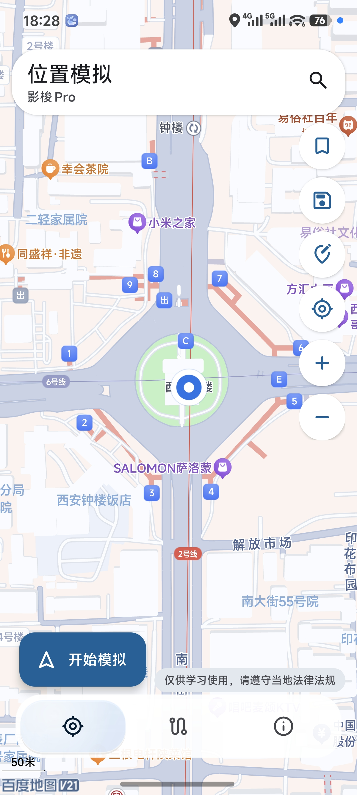
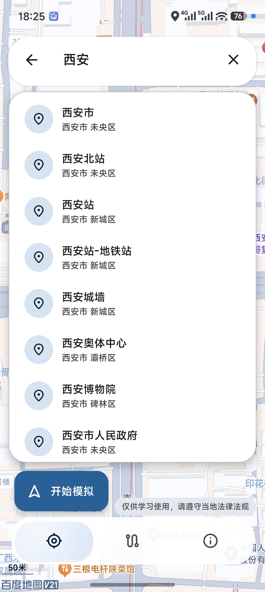
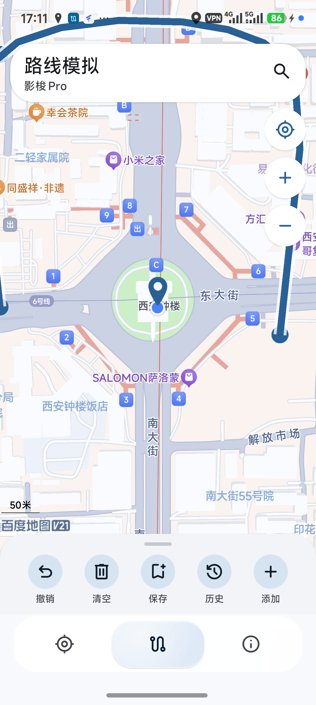
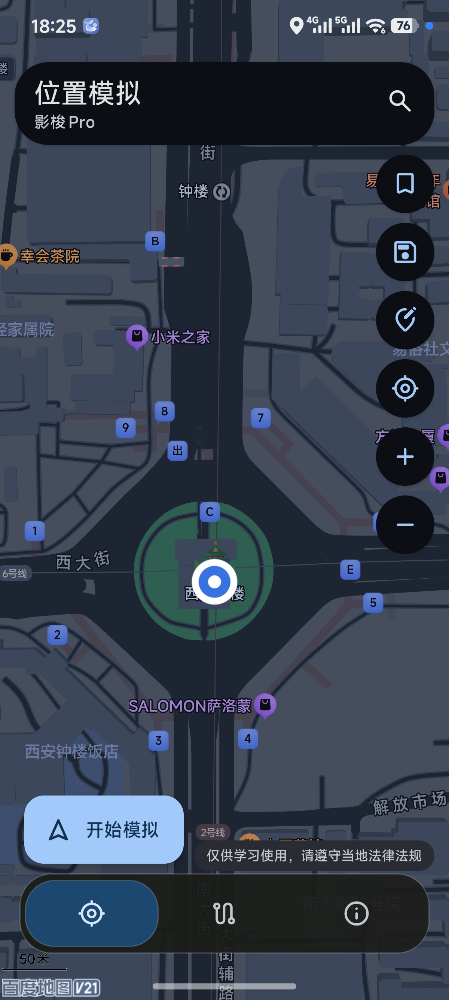
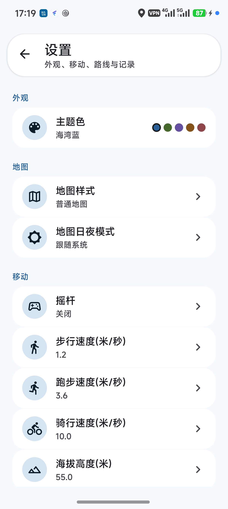
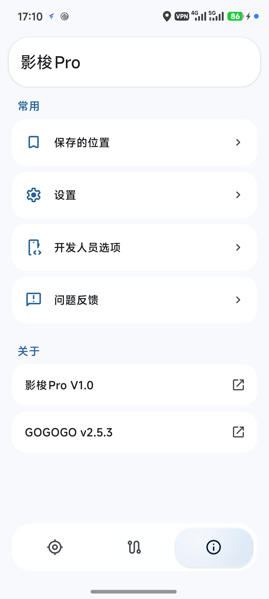

# YingSuoPro

YingSuoPro is an Android mock-location app built on [GoGoGo](https://github.com/ZCShou/GoGoGo). No root access is required. It is intended for Android development debugging, location flow testing, and learning.

> For development, testing, and educational use only. Please comply with applicable local laws and regulations.

[Repository](https://github.com/Mortonnn/YingSuoPro) · [Releases](https://github.com/Mortonnn/YingSuoPro/releases) · [Issues](https://github.com/Mortonnn/YingSuoPro/issues)

---

## Features

- **Location Mock**: Pick a point directly on the map, search places, or enter coordinates (supporting BD09 and GPS WGS84), then start or stop mock location with one tap.
- **Route Simulation**: Add multiple waypoints to build and smooth a route on the map, customize speed, speed fluctuation, update interval, repeat count, and altitude, and save/load/rename saved routes.
- **Floating Joystick**: Choose between circular or D-pad styles (off by default, configurable in Settings) with walking, running, and cycling speed presets.
- **History Management**: Locally stores position and route history in SQLite with configurable retention, search filtering, and one-tap reuse.
- **Multi-tier Search Fallback**: Uses `Baidu Suggestion → Baidu Web Search → OpenStreetMap Nominatim` fallback for place search, and uses Android system location for "Current Location" (prioritizing the active mock location while running).
- **Material 3 UI & Theme**: Uses Ocean Blue by default with unified app, notification, and status-bar icons, while allowing switching among 5 in-app color palettes (`Ocean`, `Lime`, `Violet`, `Sunset`, `Rose`) and full dark-mode support for both UI and Baidu Maps 9.0 basemaps.

---

## Screenshots

| Location Mock (Light) | Place Search | Route Simulation |
| :---: | :---: | :---: |
|  |  |  |

| Dark Mode | Settings | About & Menu |
| :---: | :---: | :---: |
|  |  |  |

---

## Setup & Usage

1. **Requirements**: Android 8.1+ (`minSdk 27`), `arm64-v8a` (16 KB memory page compatible for Android 15+).
2. **Download**: Get the latest APK (currently `V1.0`) from [GitHub Releases](https://github.com/Mortonnn/YingSuoPro/releases).
3. **Enable Mock Location**: Open **Settings → About phone** and tap **Build number** to unlock **Developer options**, then select **YingSuoPro** under **Select mock location app**. Grant Location, Notification, and (if using the joystick) Overlay permissions when prompted.

---

## Acknowledgement & License

- Built on [ZCShou/GoGoGo](https://github.com/ZCShou/GoGoGo). Many thanks to ZCShou and all upstream contributors.
- Licensed under **GPL-3.0-only**. Upstream copyright belongs to ZCShou; modifications are maintained by [Mortonnn](https://github.com/Mortonnn).
