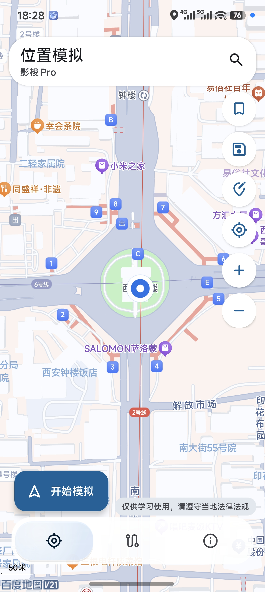
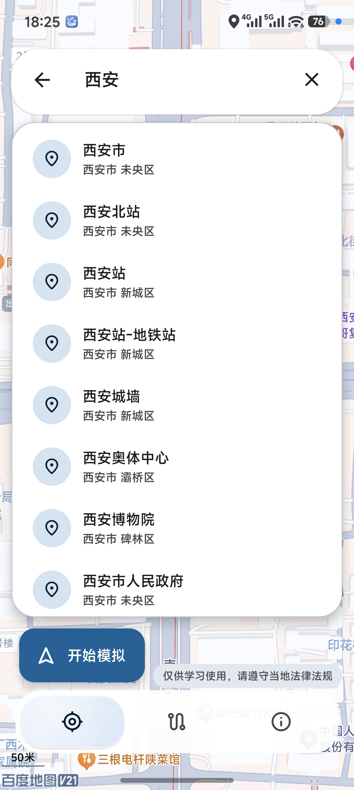
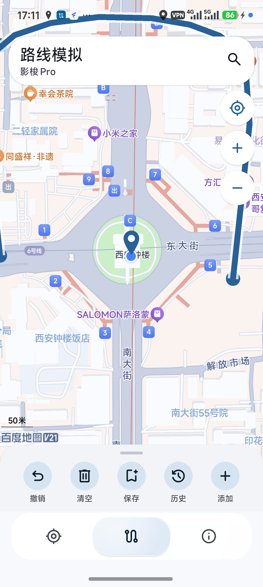
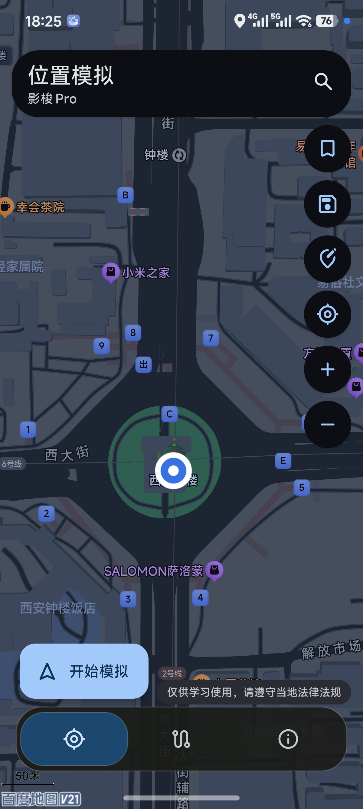
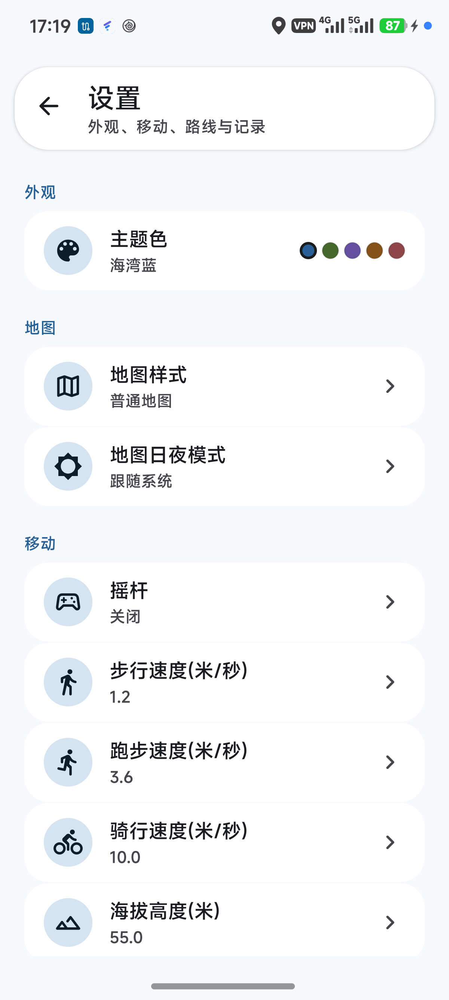
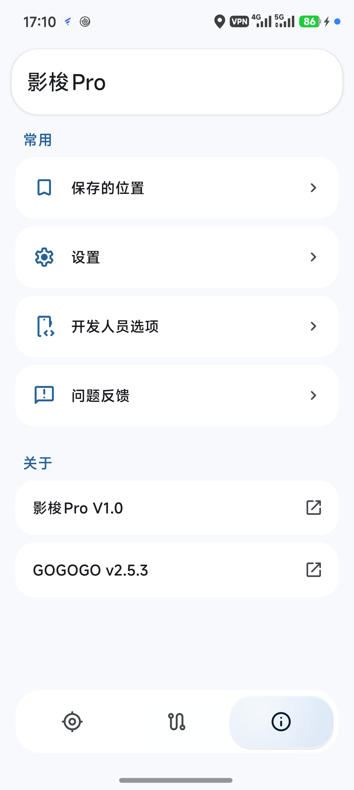

# 影梭Pro (YingSuoPro)

影梭Pro 是一款基于 [GoGoGo](https://github.com/ZCShou/GoGoGo) 开发与优化的 Android 模拟定位工具，无须 Root 即可使用，主要用于 Android 开发调试、定位流程测试与学习交流。

> 本软件仅供开发测试与学习研究使用，请严格遵守所在地法律法规，切勿用于任何违法违规用途。

[仓库主页](https://github.com/Mortonnn/YingSuoPro) · [下载安装包 (Releases)](https://github.com/Mortonnn/YingSuoPro/releases) · [问题反馈 (Issues)](https://github.com/Mortonnn/YingSuoPro/issues)

---

## 主要功能

- **位置模拟**：支持地图直接选点、地点搜索与经纬度手动输入（支持 BD09 百度坐标与 GPS WGS84 坐标），一键开启或停止全局模拟定位。
- **路线模拟**：支持在地图上依次添加多个途经点形成轨迹并绘制平滑路线，可配置移动速度、速度浮动、刷新间隔、循环次数与海拔高度，支持开始、暂停、继续、停止及路线保存/载入。
- **悬浮摇杆**：支持圆形摇杆与按键方向两种样式（默认关闭，可在设置中开启），配合步行、跑步、骑行三档速度微调模拟位置。
- **历史记录**：本地记录曾模拟过的位置与保存的路线，支持按过期天数自动清理、搜索过滤与一键复用。
- **多级搜图兜底**：搜索地点采用 `百度地点建议 → 百度地图网页搜索 → OpenStreetMap Nominatim` 多级兜底；“返回当前位置”在模拟运行时优先回到当前模拟位置，未模拟时使用系统定位（GPS / 网络），不再强依赖额外定位 SDK。
- **Material 3 外观与主题**：默认采用海湾蓝（Ocean Blue）统一应用与状态栏/通知图标，界面支持海湾蓝、青柠绿、暮光紫、日落橙、樱花粉 5 套应用内主题色切换，并全面适配系统深色模式及百度地图日夜底图。

---

## 运行界面

| 首页位置模拟（浅色） | 地点搜索下拉 | 路线模拟（浅色） |
| :---: | :---: | :---: |
|  |  |  |

| 首页位置模拟（深色） | 参数与主题设置 | 关于与常用入口 |
| :---: | :---: | :---: |
|  |  |  |

---

## 安装与使用说明

### 1. 系统要求

- **系统版本**：Android 8.1 及以上（`minSdk 27`）
- **支持架构**：ARM64（`arm64-v8a`），已适配 Android 15+ 的 16 KB 内存页大小

### 2. 安装应用

前往 [Releases](https://github.com/Mortonnn/YingSuoPro/releases) 下载最新版本的 `arm64-v8a` 安装包（当前版本 `V1.0`）并完成安装。

### 3. 开启“选择模拟位置信息应用”

影梭Pro 通过 Android 原生模拟位置接口工作，通常**不需要 Root**，但需要按以下步骤授权：

1. 打开手机 **设置 → 关于手机**，连续点击 **版本号**（或 MIUI / HyperOS 版本）直至提示“已开启开发者模式”。
2. 进入 **设置 → 系统 / 更多设置 → 开发者选项**。
3. 找到 **选择模拟位置信息应用**，选中 **影梭Pro**。
4. 首次打开影梭Pro，按提示授予 **位置权限** 与 **通知权限**；如需使用悬浮摇杆，请再前往系统权限中允许 **显示在其他应用上层（悬浮窗）** 权限。

### 4. 开始模拟

- **定点模拟**：在首页地图选点、通过顶部搜索框搜地点或长按输入经纬度后，点击左下角 **开始模拟**。
- **路线模拟**：切换到中间 **路线模拟** 标签，将准星对准途径地点点击 **添加**，添加 2 个及以上节点后点击左下角 **开始模拟**；运行中可随时暂停或调整速度参数。
- **摇杆微调**：在 **设置 → 移动 → 摇杆** 中选择 `圆形` 或 `按键` 后，开启模拟即会显示桌面悬浮摇杆。

---

## 常见问题

**Q：为什么地图上选点正常，开启模拟后部分软件位置仍未变化或存在几百米偏差？**  
A：首先请确认已在“开发者选项”中正确指定 影梭Pro 为模拟位置信息应用，且手机的后台限制与省电策略未杀掉本应用服务。其次，国内地图（如百度 BD09、高德 GCJ02）与国际标准 GPS（WGS84）坐标系不同，应用内部已做常见转换，但仍可能受目标应用自身定位来源（IP / Wi-Fi / 基站辅助定位）及缓存影响。

**Q：后台模拟一段时间后自动停止怎么办？**  
A：建议在手机的电池管理中将影梭Pro设为“无限制 / 允许后台高耗电”，并在多任务界面锁定应用，同时保持位置模拟的常驻通知权限开启。

**Q：在哪里提交 Bug 或功能建议？**  
A：可通过应用内 **关于 → 问题反馈** 导出本地运行日志，或直接在 [GitHub Issues](https://github.com/Mortonnn/YingSuoPro/issues) 反馈，并附上软件版本、手机型号、Android 版本与复现步骤。反馈截图与路线前请注意隐私保护，避免包含个人住址信息。

---

## 致谢与许可

- 本项目基于 [ZCShou](https://github.com/ZCShou) 的开源项目 [GoGoGo](https://github.com/ZCShou/GoGoGo) 进行二次开发与改进，感谢原作者及所有贡献者提供的底层架构与定位实现。
- 如果这个项目对你有所帮助，也欢迎前往原仓库 [ZCShou/GoGoGo](https://github.com/ZCShou/GoGoGo) 点一个 Star。
- 本项目遵循 **GPL-3.0-only** 开源协议，原代码版权归 ZCShou 所有，修改与新增部分由 [Mortonnn](https://github.com/Mortonnn) 维护。
